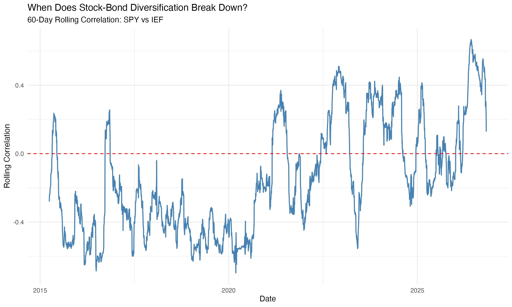
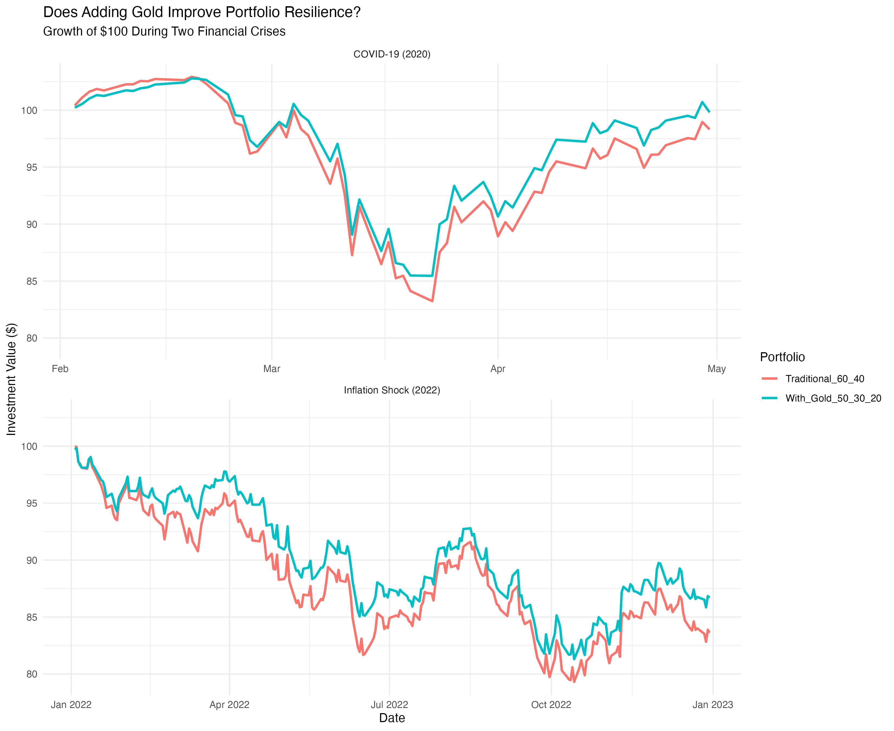

```{r setup, include=FALSE}
knitr::opts_chunk$set(echo = TRUE)
```

# 1. Introduction

One of the key principles of risk management in a portfolio is diversification. Investors can reduce the level of market volatility risk through the inclusion of non-correlated assets. Traditionally, the asset combination includes equities and government bonds as bonds offered the protection from the equity markets during crises.

However, diversification is not always equally effective in all economic situations. During the 2020 COVID-19 market crash, government bonds acted as protection from equity risk. At the same time, the situation of 2022 characterized by inflation and increased interest rates created conditions for the fall of both equity and bond assets. 

The current research focuses on the analysis of changes in the effectiveness of the diversification approach between the two crises. Also, the impact of adding gold to the portfolio will be evaluated.

## Research Questions

1. How did stock-bond diversification perform during the 2020 COVID-19 crash compared with the 2022 inflation shock?
2. How did the relationship between stock and bond returns change across these periods?
3. Did adding gold improve portfolio returns, volatility, and maximum drawdown?

## Research Approach

The analysis uses historical daily market data for three exchange-traded funds (ETFs):

- **SPY:** Represents U.S. large-cap equities through the S&P 500.
- **IEF:** Represents intermediate-term U.S. Treasury bonds.
- **GLD:** Represents gold exposure.

Two hypothetical portfolios are compared:

- **Traditional portfolio:** 60% SPY and 40% IEF.
- **Alternative portfolio:** 50% SPY, 30% IEF, and 20% GLD.

This study analyzes cumulative returns, annualized volatility, maximum drawdown, and stock-bond correlations. It also looks into rolling correlation to better understand how diversification works over time.

The task is not to find a universally optimum portfolio, but to examine how different portfolio compositions worked in varying financial markets.

# 2. Data and Methodology

## 2.1 Data Description

This study uses daily historical price data from January 2015 to October 2026 for three exchange-traded funds (ETFs):

- **SPY:** Tracks the S&P 500 Index and represents U.S. equities.
- **IEF:** Tracks intermediate-term U.S. Treasury bonds and represents government bonds.
- **GLD:** Tracks the price of gold and represents a potential safe-haven asset.

Historical adjusted closing prices for SPY, IEF, and GLD were obtained from Yahoo Finance using the quantmod package in R.

Two periods were selected for comparison:

- **COVID-19 crisis:** February 1 to April 30, 2020.
- **Inflation shock:** January 1 to December 31, 2022.

These time periods were chosen since they represent different economic conditions and allow us to investigate how diversification performs under different types of market stress.

## 2.2 Daily Return Calculations

Daily returns were calculated using the percentage change in each asset's price between consecutive trading days.

The daily return formula is:

$$
R_t = \frac{P_t - P_{t-1}}{P_{t-1}} \times 100
$$

where:

- $R_t$ represents the daily percentage return.
- $P_t$ represents the asset price on day $t$.
- $P_{t-1}$ represents the asset price on the previous trading day.

Daily returns allow us to compare assets with different price levels. They are also used throughout the analysis to calculate volatility, correlations and portfolio performance.

## 2.3 Portfolio Construction

To test the effectiveness of portfolio diversification in financial crises, two hypothetical investment portfolios were created for comparison.

The first portfolio contains assets in a ratio of 60% stocks (SPY) and 40% government bonds (IEF).

In the second portfolio, gold is included as an additional asset, making up 50%, 30%, and 20% of equities (SPY), government bonds (IEF), and gold (GLD), respectively.

The daily portfolio return is calculated based on the formula:

$$
R_{p,t} = \sum_{i=1}^{n} w_i R_{i,t}
$$

where:

- $R_{p,t}$ is the portfolio return on day $t$.
- $w_i$ is the portfolio weight assigned to asset $i$.
- $R_{i,t}$ is the daily return of asset $i$.
- $n$ is the number of assets in the portfolio.

For the traditional portfolio:

$$
R_{60/40,t} = 0.60R_{SPY,t} + 0.40R_{IEF,t}
$$

For the alternative portfolio:

$$
R_{50/30/20,t} = 0.50R_{SPY,t} + 0.30R_{IEF,t} + 0.20R_{GLD,t}
$$

Portfolio weights are held constant when calculating daily returns; therefore, a daily rebalance is assumed. Transaction costs and taxes are ignored.

The purpose is to compare the historical performance of these two portfolios, not to identify an optimal portfolio.

## 2.4 Risk Measures

Three main risk measures were used to evaluate the performance of individual assets and investment portfolios: volatility, maximum drawdown, and correlation.

### Annualized Volatility

Volatility is the measure of how much the investment returns vary. Greater volatility means more variation in returns and thus more uncertainty.

Annualized volatility was calculated using:

$$
\sigma_{\text{annual}} = \sigma_{\text{daily}} \sqrt{252}
$$

where $\sigma_{\text{daily}}$ is the standard deviation of daily percentage returns, and 252 represents the approximate number of trading days in a year.

### Maximum Drawdown

Maximum Drawdown is the largest percentage decline of an investment from a prior peak to a subsequent trough over the specified period.

$$
DD_t = \frac{V_t - V_{\text{peak},t}}{V_{\text{peak},t}} \times 100
$$

where $V_t$ is the investment value at time $t$ and $V_{\text{peak},t}$ is the highest value reached up to that point, including the initial investment value.

The maximum drawdown is the most negative value of $DD_t$ during the period.

### Correlation

Correlation measures the strength and direction of the linear relationship between two assets' returns.

$$
\rho_{X,Y} =
\frac{\operatorname{Cov}(X,Y)}
{\sigma_X \sigma_Y}
$$

Correlation ranges from -1 to +1. Negative correlation means that assets tend to move in opposite directions. Positive correlation means that assets tend to move in the same direction. 

A 60-trading-day rolling correlation was also calculated to examine the change in the correlation between stock and bond returns over time.

# 3. Empirical Results

## 3.1 Stock-Bond Correlations During Financial Crises

The correlation between stock and bond returns differed considerably between the two crisis periods.

| Crisis Period | SPY-IEF Correlation |
|:---|---:|
| COVID-19 Crisis (2020) | -0.554 |
| Inflation Shock (2022) | 0.190 |

During the COVID-19 crisis, the stock and bond returns were negatively correlated at around -0.554, meaning that the stock and bond returns were moving in opposite directions.

In contrast, during the inflation shock of 2022, the correlation was positive around 0.190. This suggests that stocks and bonds are more likely to move in the same direction, reducing the potential diversification benefits of holding both assets.

Results indicate that the effectiveness of stock-bond diversification depends on the economic situation.

### 60-Day Rolling Correlation

To further examine the relationship between stocks and bonds, a 60-trading-day rolling correlation was calculated. This allows us to observe how the correlation changed over time rather than relying only on the average correlation during each crisis.


```{r rolling-correlation-figure, echo=FALSE, out.width='100%', fig.align='center'}

```

The 60-day rolling correlation graph indicates that the relationship between stock and bond returns changed significantly over time.

In the 2020 COVID-19 crisis, the correlation was strongly negative, meaning stocks and bonds tended to move in opposite directions. However, in 2022, the correlation rose and was positive for parts of the year, meaning stocks and bonds were more likely to move in the same direction.

The results indicate that stock-bond diversification may not be effective in all economic environments. Government bonds can provide protection in some financial crises, but if stock and bond returns are positively correlated, the ability to reduce risk in a portfolio can be diminished.

## 3.2 Portfolio Performance During Financial Crises

To examine whether including gold improved portfolio performance, two investment portfolios were compared during the COVID-19 crisis and the 2022 inflation shock.

The table below presents the cumulative returns of both portfolios during each crisis.

| Crisis Period | Traditional 60/40 Portfolio | Alternative 50/30/20 Portfolio |
|:---|---:|---:|
| COVID-19 Crisis (2020) | -1.69% | -0.19% |
| Inflation Shock (2022) | -16.39% | -13.30% |

During the COVID-19 crisis, the traditional 60/40 portfolio lost approximately 1.69% cumulatively, whereas the alternative portfolio with gold lost only 0.19%.

The difference was more noticeable in the inflation shock in 2022. The traditional portfolio lost about 16.39% compared to a 13.30% loss for the alternative portfolio.

These results suggest that the alternative portfolio performed better in both crises with smaller cumulative losses. However, the alternative portfolio also had different stock and bond allocations, so the improvement cannot be attributed to gold alone.

### Portfolio Performance Comparison

The following graph shows the growth of an initial $100 investment in each portfolio during the two crisis periods.

```{r portfolio-comparison-figure, echo=FALSE, out.width='100%', fig.align='center'}

```

## 3.3 Portfolio Risk Comparison

Cumulative returns alone do not provide a complete picture of investment performance. To further evaluate the two portfolios, the annualized volatility and maximum drawdowns were compared during both crises.

### Annualized Volatility

| Crisis Period | Traditional 60/40 Portfolio | Alternative 50/30/20 Portfolio |
|:---|---:|---:|
| COVID-19 Crisis (2020) | 33.22% | 29.62% |
| Inflation Shock (2022) | 15.84% | 14.24% |

### Maximum Drawdown

| Crisis Period | Traditional 60/40 Portfolio | Alternative 50/30/20 Portfolio |
|:---|---:|---:|
| COVID-19 Crisis (2020) | -19.13% | -16.86% |
| Inflation Shock (2022) | -20.69% | -18.70% |

The volatility of the traditional portfolio during the COVID-19 outbreak period stood at 33.22%, whereas that of the alternative portfolio was 29.62%. Similarly, during the 2022 inflation crisis, the alternative portfolio had a volatility of 14.24%, which was lower than the traditional portfolio's 15.84%.

From the maximum drawdown results, one can observe the same trend. For instance, during the COVID-19 period, the traditional portfolio had a maximum drawdown of 19.13%, whereas the maximum drawdown for the alternative portfolio was 16.86%. Similarly, during 2022, the maximum drawdown for the two portfolios were 20.69% and 18.70%, respectively.

Therefore, from the results shown above, the alternative portfolio exhibited lower risk according to these measures than the traditional portfolio, judging from the volatility and maximum drawdown. These findings are supported by the cumulative return results as well.

# 4. Discussion

## 4.1 Why Did Diversification Perform Differently?

The findings indicate that the effectiveness of the diversification strategy depends on the nature of the economic shock.

During the coronavirus pandemic in 2020, returns from stocks and bonds were negatively correlated. With falling stock prices, government bonds served as a means of protecting investors against potential losses. Thus, it is possible to demonstrate that when using assets that move in opposite directions, the portfolio risks decrease.

Conversely, in the case of inflation in 2022, an increase in interest rates impacted bonds negatively. Furthermore, stock markets saw a significant decline at the same time. As a result, there was positive correlation between the returns of bonds and stocks, which limited the effect of portfolio diversification.

Thus, it is possible to say that government bonds cannot always serve as a safe haven during a fall in stock markets, as their effectiveness depends on the economic factors influencing this process.

## 4.2 Did Adding Gold Improve Diversification?

From the data obtained above, one can conclude that the alternative portfolio, which includes gold, outperformed the traditional 60/40 portfolio during the periods of crises.

In particular, during the COVID-19 crisis, the alternative portfolio demonstrated smaller cumulative losses, as well as lower volatility and maximum drawdown compared to the traditional portfolio. This pattern was also observed during the 2022 inflation crisis, when both equities and bonds declined sharply.

The results obtained above indicate that an alternative asset allocation that includes gold may help protect a portfolio during the period of financial market stress. It is worth noting that this does not automatically mean that gold itself was the reason for the difference in the performance of portfolios.

In addition, the alternative portfolio has lower allocations of both equities and bonds in its composition. Thus, the difference in the performance can be explained by the combination of both of these factors.

## 4.3 Limitations of the Analysis

However, there are certain limitations of the research that need to be noted despite the usefulness of its findings concerning portfolio diversification.

First of all, the study only analyzes two financial crises, namely the crisis connected with the outbreak of the novel coronavirus in 2020 and the inflation-related financial crisis of 2022. This means that the obtained results may not be generalizable to any other circumstances.

Secondly, only two different types of portfolio allocation are compared within this research. As the alternative portfolio includes both gold and reducing the weights of stocks and bonds, it becomes difficult to isolate the effect of the addition of gold.

Thirdly, the analysis assumes daily portfolio rebalancing and does not take into account transaction fees or taxes.

Last but not least, the results are based on historical market data which means that the portfolio may behave differently during the financial crisis in the future.

# 5. Conclusion

This research examined the effectiveness of the stock-bond diversification strategy during two economic downturns, namely the stock market crash during the COVID-19 pandemic and the inflation shock of 2022. It also analyzed whether a portfolio containing gold outperformed the traditional stock-bond portfolio.

The findings indicate that the performance of the stock-bond diversification strategy varied during these two events. In the first case, the stock and bond returns were negatively correlated, which allowed using the government bonds as protection from losses due to stocks. However, during the second crisis, the correlation became positive, making diversification less effective.

In comparison with the traditional portfolio, the alternative one had smaller cumulative losses, lower annualized volatility, and smaller maximum drawdowns in both cases. However, the differences between the portfolios cannot be attributed only to the presence of gold in the alternative portfolio since its composition is different from the traditional portfolio.

Thus, it can be concluded that despite the importance of the diversification strategy, its effectiveness will depend not only on the economic environment but also on the relationship between the asset returns. This means that investors need to consider the response of different assets to various shocks.